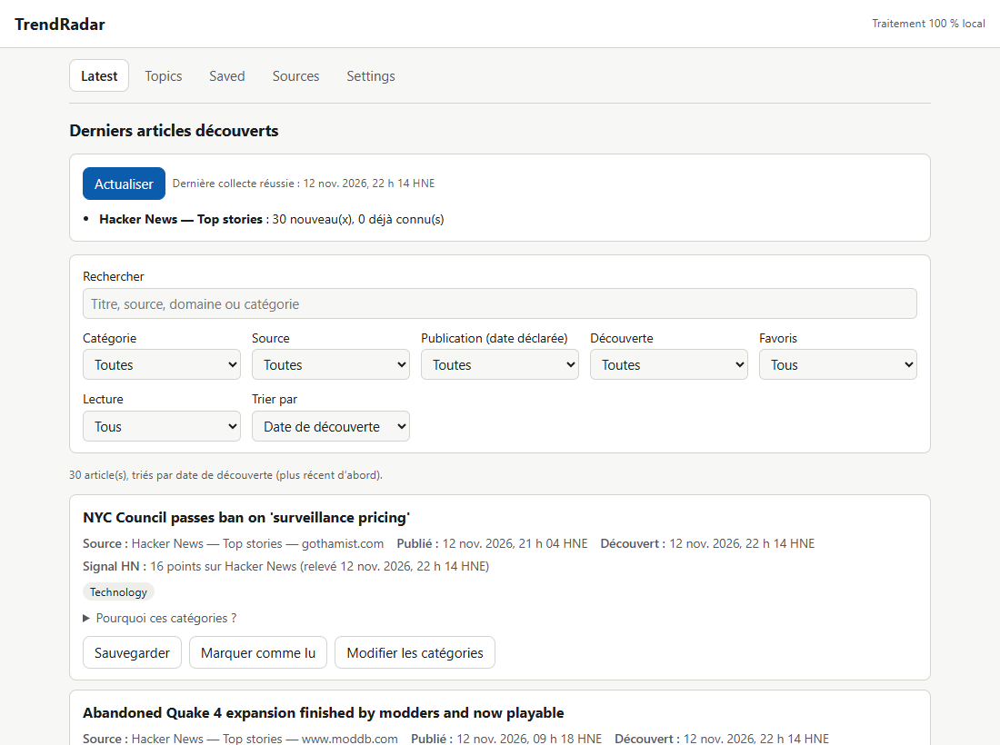
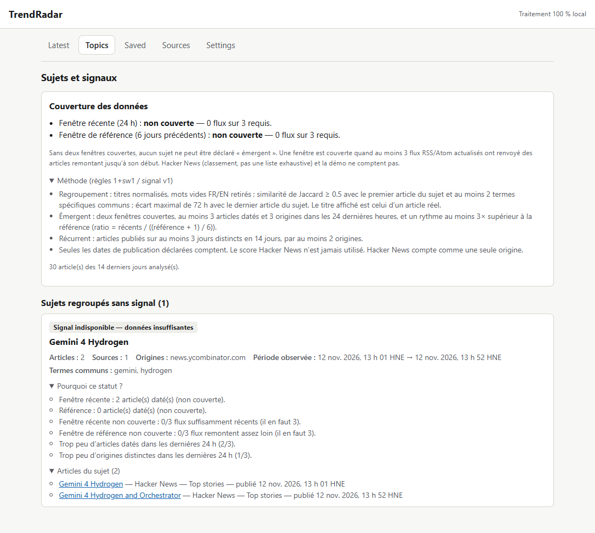
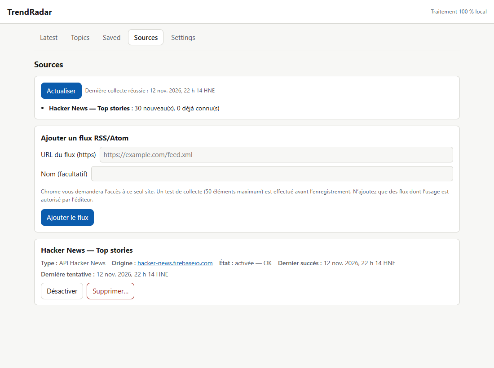
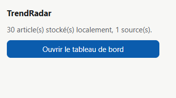

# TrendRadar

Extension Chrome (Manifest V3) de **veille d'actualités local-first**. Elle centralise des sources autorisées (API
officielle Hacker News, flux RSS/Atom choisis par l'utilisateur). Chaque article reste relié à sa provenance et à des
dates traçables, et un signal de tendance n'est affiché **que lorsque les données le justifient**.



## Le problème

Suivre la technologie, le développement web, WordPress/PHP, l'IA ou la cybersécurité oblige à parcourir chaque jour de
nombreux sites. Les outils de veille courants promettent souvent du « temps réel » ou des « tendances » sans montrer
d'où viennent les chiffres. TrendRadar fait l'inverse :

- **chaque article** affiche sa source, son domaine, sa **date de publication déclarée** et, séparément, sa **date de découverte**. Une date absente reste « indisponible », jamais remplacée par l'heure de collecte ;
- **chaque catégorie** est justifiée (« Pourquoi ces catégories ? ») et peut être corrigée à la main ;
- **chaque sujet** montre ses articles, ses origines, sa période observée et la règle appliquée. Sans couverture suffisante, l'écran affiche « Signal indisponible — données insuffisantes ».

## Fonctionnalités

|                       |                                                                                                                                                                                                                                                        |
| --------------------- | ------------------------------------------------------------------------------------------------------------------------------------------------------------------------------------------------------------------------------------------------------ |
| **Sources**           | API officielle Hacker News (30 éléments) ; flux RSS 2.0, RSS 1.0 et Atom ajoutés par l'utilisateur, avec une **permission Chrome demandée site par site** ; santé des sources (dernier succès, erreur, action recommandée, pause en cas de limitation) |
| **Collecte**          | Manuelle (« Actualiser »), isolée par source ; idempotente : une collecte rejouée ne crée aucun doublon ; une source en panne n'empêche pas les autres de se mettre à jour                                                                             |
| **Déduplication**     | Par identifiant de source, puis par URL canonique (paramètres de suivi retirés avec prudence) ; toutes les provenances sont conservées                                                                                                                 |
| **Exploration**       | Recherche sans accents ; filtres par catégorie, source, favoris, lu/non lu, **publiés** aujourd'hui ou sur 7 jours (dates déclarées uniquement), **découverts** aujourd'hui ou sur 7 jours, date inconnue ; tri reproductible                          |
| **Catégories**        | 11 catégories de départ ; classement déterministe par mots-clés avec exclusions ; catégories personnalisées ; correction manuelle par article                                                                                                          |
| **Sujets et signaux** | Regroupement déterministe et versionné ; statuts **émergent**, **récurrent** ou **données insuffisantes**, selon la couverture de 3 flux, la diversité des origines et une comparaison 24 h / 6 jours ([méthode](TREND_METHOD.md))                     |
| **Vie privée**        | Aucun serveur, aucun outil d'analyse d'audience ; `permissions: []` ; suppression totale qui révoque aussi les accès aux sites                                                                                                                         |

| Sujets et méthode                      | Sources et santé                         | Popup                                |
| -------------------------------------- | ---------------------------------------- | ------------------------------------ |
|  |  |  |

Les captures viennent de l'**extension réellement installée**, avec des données **réelles** de l'API Hacker News du 12 novembre 2026. Elles sont produites par `e2e/screenshots.spec.ts` et ne sont pas retouchées.

## Installation

Prérequis : Node.js ≥ 20 (testé avec 24.15.0) et npm.

```bash
npm ci
npm run build
```

Ouvrez ensuite `chrome://extensions`, activez le **mode développeur**, cliquez **Charger l'extension non empaquetée** et
sélectionnez `dist/`. Ouvrez la popup, puis le tableau de bord. Dans **Sources**, ajoutez Hacker News ou un flux RSS,
puis cliquez **Actualiser**.

Pour visualiser l'interface sans réseau : **Settings → Charger la démo**. Cela charge 5 articles **fictifs**, marqués « Démo », avec des liens vers `example.com`. La démo se retire à tout moment.

## Scripts

| Commande                                                    | Rôle                                                                                                                                                                              |
| ----------------------------------------------------------- | --------------------------------------------------------------------------------------------------------------------------------------------------------------------------------- |
| `npm run check`                                             | Vérification TypeScript, ESLint, tests Vitest, build de production, puis `scripts/verify-dist.mjs`                                                                                |
| `npm test`                                                  | Tests unitaires, d'intégration IndexedDB et d'interface (Testing Library)                                                                                                         |
| `npm run test:e2e`                                          | Build, puis tests Playwright sur **l'extension chargée dans Chromium** (persistance, accessibilité axe, clavier, 360 px). Ajoutez `E2E_NETWORK=1` pour l'appel réel à Hacker News |
| `SCREENSHOTS=1 npx playwright test e2e/screenshots.spec.ts` | Régénère les captures du README                                                                                                                                                   |
| `node scripts/generate-icons.mjs`                           | Régénère les icônes, sans dépendance                                                                                                                                              |

## Qualité vérifiée

Dernière exécution le 12 novembre 2026. Le détail figure dans [`TEST_REPORT.md`](TEST_REPORT.md).

- **210 tests Vitest** : parseurs avec documents hostiles (XXE), client réseau (erreurs 401/403/429/500, délais, taille, redirections), déduplication idempotente, dates et changements d'heure, classement, filtres, sujets, signaux sur historiques **synthétiques identifiés comme tels**, budgets de performance sur 2 000 articles.
- **7 tests Playwright** sur l'extension installée : aucune permission obligatoire, persistance après redémarrage du navigateur, collecte réelle Hacker News idempotente, **0 violation axe WCAG 2.2 A/AA** en thème clair et sombre, navigation au clavier, aucun défilement horizontal à 360 px.
- **Contrôle du build** : CSP stricte, aucune permission interdite, aucun secret, aucun `eval`, aucun hôte inattendu. `npm audit` : **0 vulnérabilité**.

## Documentation

| Document                                       | Contenu                                                                                              |
| ---------------------------------------------- | ---------------------------------------------------------------------------------------------------- |
| [`ARCHITECTURE.md`](ARCHITECTURE.md)           | Pipeline, modules, décisions et alternatives écartées, sécurité réseau, limites de MV3, performances |
| [`DATA_DICTIONARY.md`](DATA_DICTIONARY.md)     | Magasins IndexedDB, dates et provenance, déduplication, migrations, suppression                      |
| [`TREND_METHOD.md`](TREND_METHOD.md)           | Règles versionnées de regroupement et de signal, seuils, couverture, biais                           |
| [`SOURCE_REGISTRY.md`](SOURCE_REGISTRY.md)     | Statut, conditions et garde-fous de chaque source                                                    |
| [`PRIVACY.md`](PRIVACY.md)                     | Ce qui est stocké, transmis et **non transmis**                                                      |
| [`KNOWN_LIMITATIONS.md`](KNOWN_LIMITATIONS.md) | Ce que TrendRadar ne fait pas, ou fait imparfaitement                                                |
| [`TEST_REPORT.md`](TEST_REPORT.md)             | Commandes exécutées et résultats observés, phase par phase                                           |

## Stack

TypeScript (strict), React 18, Vite 7, zod, idb (IndexedDB), Vitest, Testing Library, fake-indexeddb, Playwright,
axe-core, ESLint et Prettier. Aucune dépendance d'exécution au-delà de React, zod et idb.

## Licence

[MIT](LICENSE) © 2026 badryoskar.

Les contenus collectés (titres, extraits, scores) restent la propriété de leurs éditeurs ; TrendRadar n'en conserve
que le minimum, avec attribution et lien d'origine (voir [`SOURCE_REGISTRY.md`](SOURCE_REGISTRY.md)).
